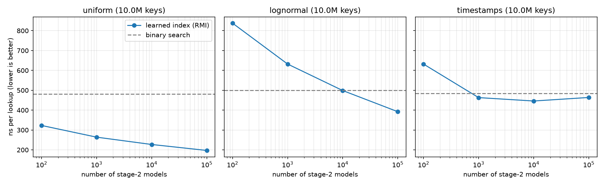
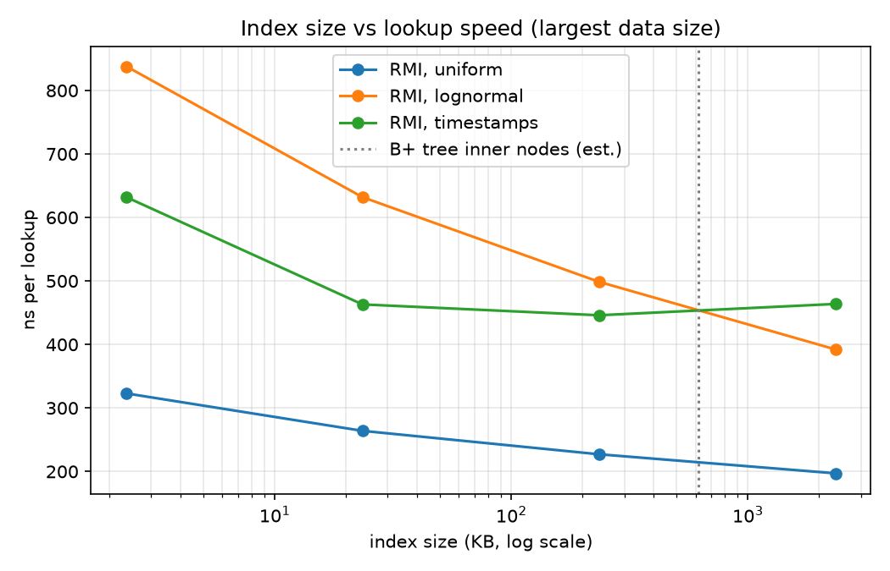

# Learned Index Structures: Can a Model Replace a B-tree?

A small replication of **"The Case for Learned Index Structures"** (Kraska, Beutel, Chi, Dean, Polyzotis, SIGMOD 2018).

**Question:** If a sorted array of keys is a function `key → position` (a CDF), can a simple machine-learning
model predict a key's position well enough to beat binary search, and when does it fail?

## Method
- **Learned index:** a 2-stage Recursive Model Index (RMI). A linear model picks one of *m* linear models,
  which predicts the position. Each model stores its maximum training error, so the final search only scans
  `[prediction − error, prediction + error]` and is **guaranteed correct**.
- **Baselines:** the same vectorised binary search over the whole array, and NumPy's C `searchsorted`
  (reference only). B+ tree inner-node size is estimated for fanout 256.
- **Data:** 100K, 1M and 10M unique keys from three distributions:
  `uniform`, `lognormal` (skewed, like prices) and `timestamps` (bursty, like order times)
- **Measurement:** 200,000 random lookups of existing keys, best of 5 runs; **every result is checked
  against `numpy.searchsorted`**.

## Results (10M keys, this laptop)
| Distribution | Binary search | Best RMI | Speed-up | Search steps |
|---|---|---|---|---|
| Uniform | 482 ns | 197 ns (100K models) | **2.4×** | 24 → 6 |
| Lognormal (skewed) | 500 ns | 392 ns (100K models) | 1.3× | 24 → 14 |
| Timestamps (bursty) | 483 ns | 446 ns (10K models) | ~1.1× | 24 → 16 |

- **Size:** on uniform keys, an RMI with 1,000 models (23.5 KB) is **1.8× faster** than binary search while being
  **~26× smaller** than estimated B+ tree inner nodes (~616 KB).
- **Where it fails:** with few models, skewed and bursty data are *slower* than binary search
  (up to 838 ns vs 500 ns), because straight lines fit their CDF badly and the error windows become huge
  (up to millions of positions). More models help on skewed data, but bursty timestamps barely improve.




## What I learned
1. Learned indexes win when the key distribution is smooth and predictable. Their advantage comes from
   *fewer search steps*, not from faster computation.
2. Model error is everything: the search window grows with the worst-case error of each model.
3. Real data is often bursty, so a learned index needs a better model (e.g. piecewise or non-linear)
   or more models, which costs memory. This is the trade-off the original paper discusses.

## Limitations
- Implemented in Python/NumPy with vectorised batch lookups, so absolute times are not comparable to C++ numbers
  in the paper; only relative comparisons with the same search code are meaningful.
- Read-only: no inserts or updates (a known open problem for learned indexes).
- The B+ tree size is an estimate, not a real implementation.

## Run it
```bash
pip install numpy matplotlib
python benchmark.py          # 100K, 1M, 10M keys; writes results/results.csv
python plot_results.py       # writes results/*.png
```
